<p align="center">
  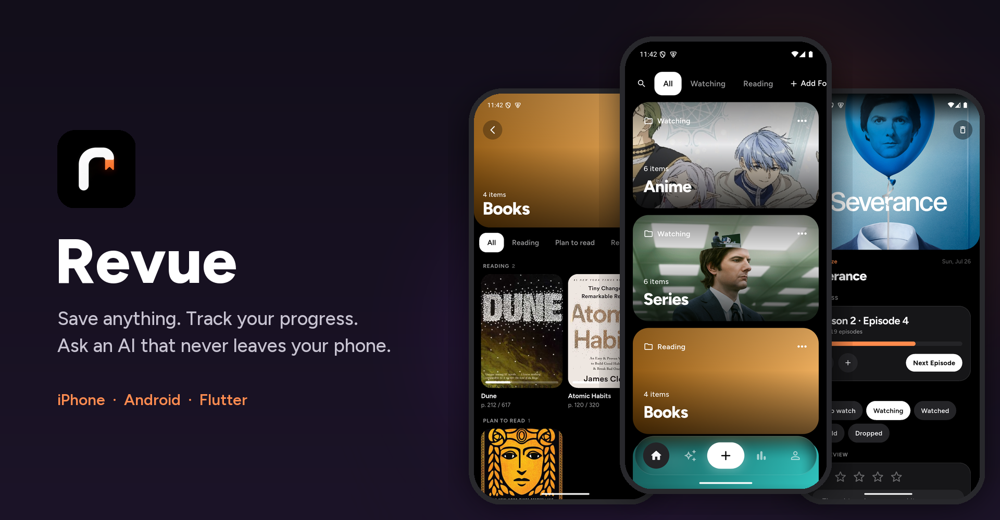
</p>

<p align="center">
  <b>A home for everything you watch, read and save.</b><br>
  Share links from any app, search shows, anime and books, track episodes and pages,<br>
  and ask an AI about your library that runs <b>entirely on your phone</b>.
</p>

<p align="center">
  
  
  
  
</p>

---

<p align="center">
  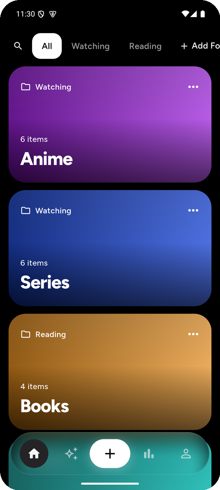
  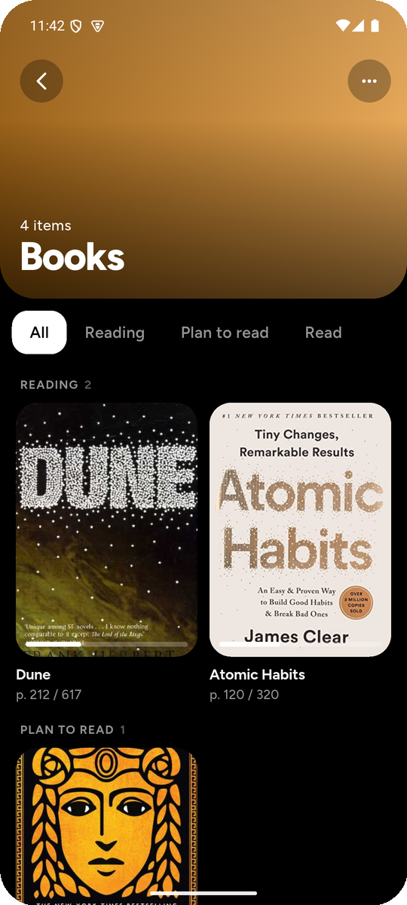
  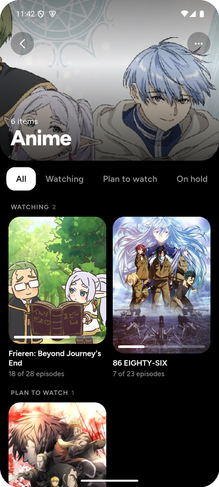
  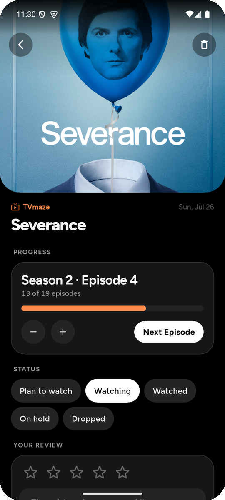
</p>

## In motion

<table>
  <tr>
    <td align="center" width="33%"><br><sub><b>Launch</b> — the r writes itself, then the bookmark drops</sub></td>
    <td align="center" width="33%">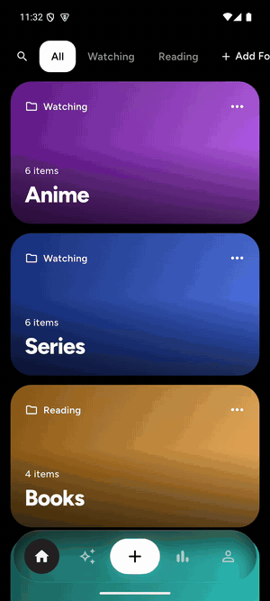<br><sub><b>The + menu</b> — the screen frosts over from the button</sub></td>
    <td align="center" width="33%">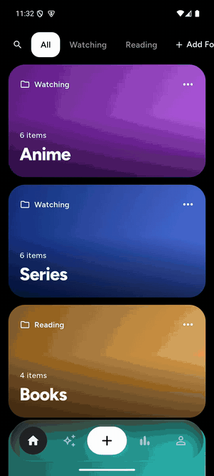<br><sub><b>Progress</b> — one tap for the next episode</sub></td>
  </tr>
</table>

## Features

### 📥 Save from anywhere
**Share → Revue** from YouTube, Chrome, Safari, TikTok and more. Revue pulls the title, channel or site, and the thumbnail on its own (YouTube oEmbed, Open Graph for everything else). Or paste a link, write a thought, or import screenshots.

### 🔎 Find a show or book in one tap
Search **series** (TVmaze), **anime** (AniList) and **books** (Open Library), then pick the status and list right as you add it. Can't find it? **Add Manually**.

<p align="center">
  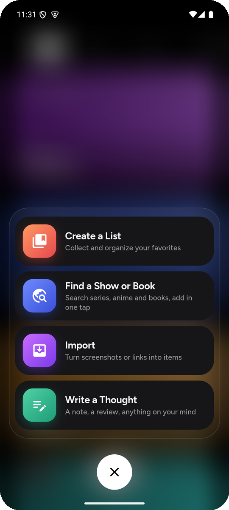
  &nbsp;
  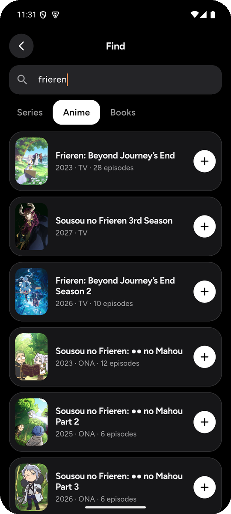
</p>

### 📈 Progress that finds itself
Revue looks up how many **episodes, seasons or pages** something has, including from anime sites like AniLiberty, and keeps ongoing shows up to date. Then it's *Next Episode* or *Set Page*, and a status for everything: Plan to watch, Watching, Watched, On hold, Dropped (or the reading versions for books).

### 🗂 Your lists, your folders
No default lists. Make your own, give each a **colour or a cover photo**, and group them into folders like *Watching* or *Reading*.

<p align="center">
  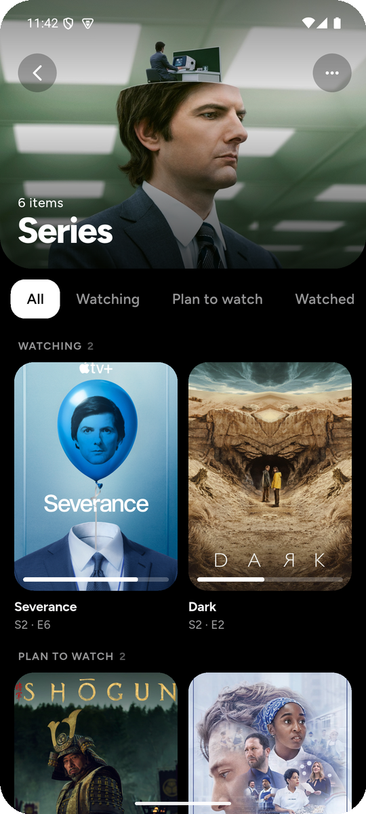
  &nbsp;
  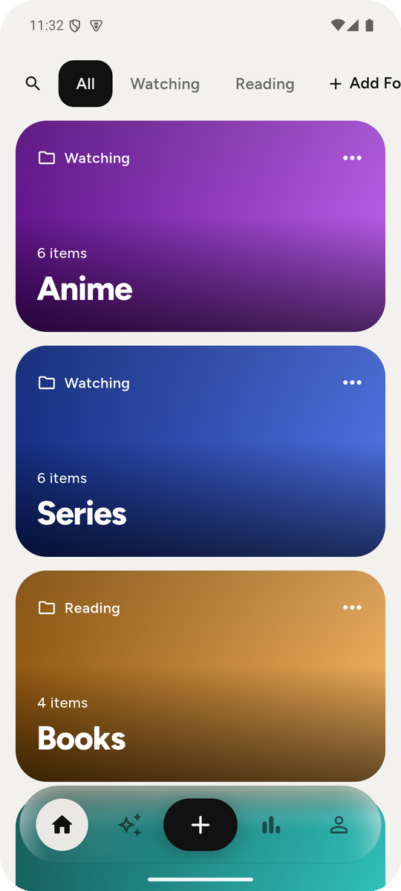
</p>

### 📊 Stats
How much you saved this week, month, year or all time, what's in progress, episodes watched, pages read, and a bar per list.

<p align="center">
  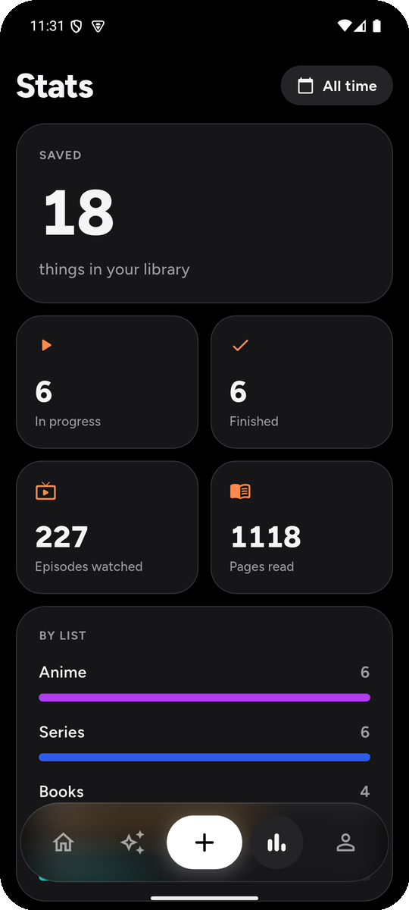
</p>

### 🖼 Screenshots, read on-device
Google ML Kit reads the text in your screenshots **on the device**. The local model then gives each one a title, a summary and tags, and any link inside is detected.

### ✨ Ask Revue
Chat with an on-device LLM (Qwen 2.5 via MediaPipe) about your library: *"what was that sci-fi book I saved?"* Before the model is downloaded, the chat works as plain search.

> **Private by design.** No account, no server, no analytics. The network is used only for link previews, catalogue lookups and downloading the model once. Google ML Kit, which reads screenshots on the device, sends Google anonymous performance metrics. Details: [Privacy Policy](PRIVACY.md).

## Light and dark

<p align="center">
  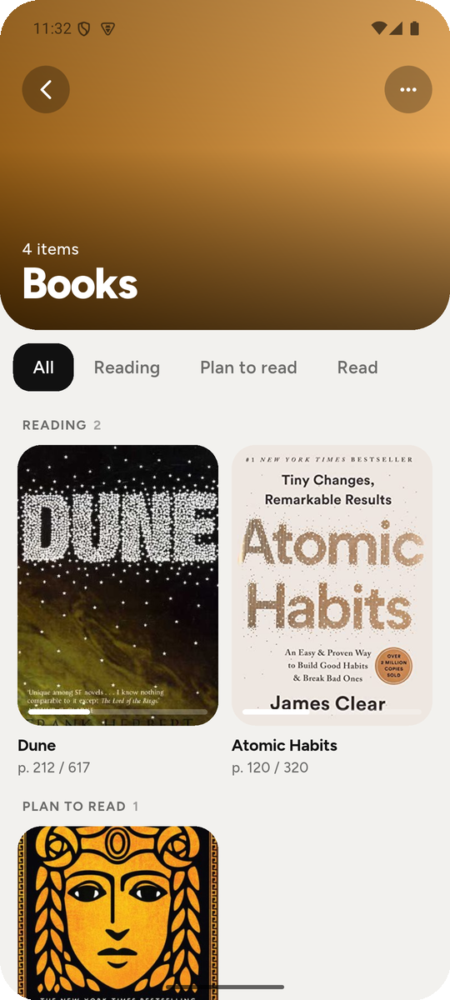
  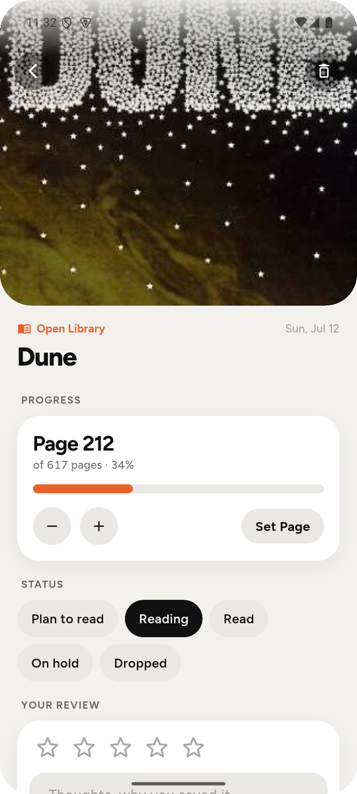
  
</p>

Revue has its own look on both platforms — the Figtree typeface, soft glass surfaces, spring animations and haptics — rather than imitating Android or iOS.

## Run it

```bash
flutter pub get
flutter run      # Android device/emulator, or iPhone
flutter test     # logic, storage and widget tests
```

- **Android** works out of the box (minSdk 24). *Share → Revue* appears automatically.
- **iOS** needs Xcode. Follow [docs/IOS_SETUP.md](docs/IOS_SETUP.md) once to add the share extension.
- **AI model**: in the app, Settings → On-device AI model → Download. The 1.5B model is about 1.6 GB, the 0.5B model about 0.5 GB.

## How it's built

| File | What |
|---|---|
| `lib/models.dart` | `Item`, `RevueList`, `Folder`, statuses and progress |
| `lib/store.dart` | The library as JSON + thumbnails on disk, with atomic saves |
| `lib/link_fetcher.dart` | YouTube oEmbed, Open Graph parsing, thumbnail download |
| `lib/catalog.dart` | Search across TVmaze, AniList and Open Library |
| `lib/progress_finder.dart` | Finds episode, season and page counts (AniLiberty, AniList, TVmaze, Open Library) |
| `lib/ai.dart` | On-device LLM (flutter_gemma), OCR (ML Kit), prompts and retrieval |
| `lib/theme.dart`, `lib/widgets.dart` | Design tokens and the shared components |
| `lib/launch_splash.dart` | The launch animation |
| `lib/pages/` | Home, lists, item, search, stats, assistant, settings, the + menu |
| `ios/ShareExtension/` | iOS share-sheet extension (see the setup doc) |

## Known limits

- `flutter_gemma` is pinned at 0.13.6; newer versions need Dart 3.12.
- The assistant picks relevant items by keyword overlap, not embeddings — fine up to a few hundred items.
- OCR covers Latin scripts only.
- The iOS build hasn't been verified on a device yet.

<sub>Cover art in the screenshots comes from TVmaze, AniList and Open Library and belongs to its owners.</sub>
